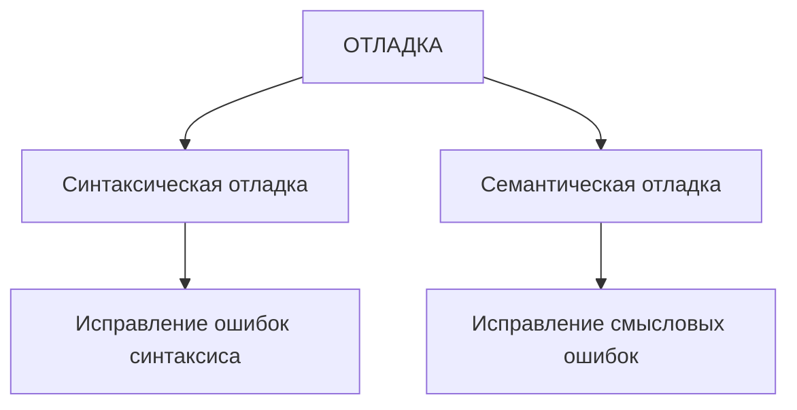
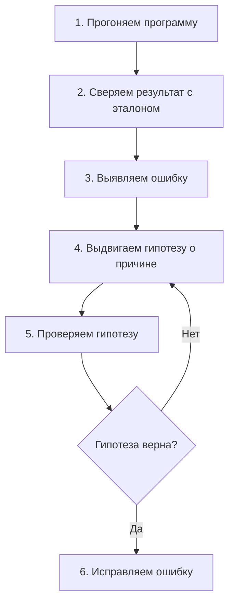
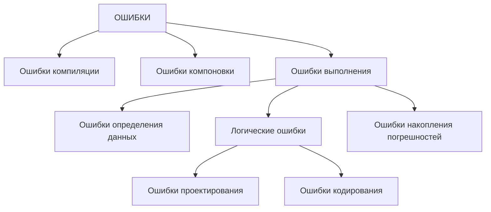
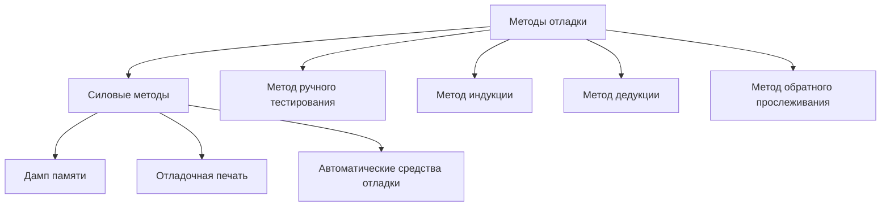
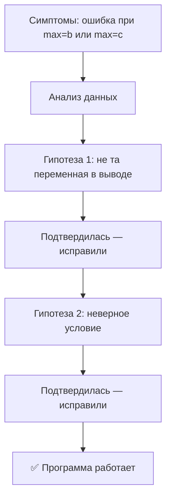
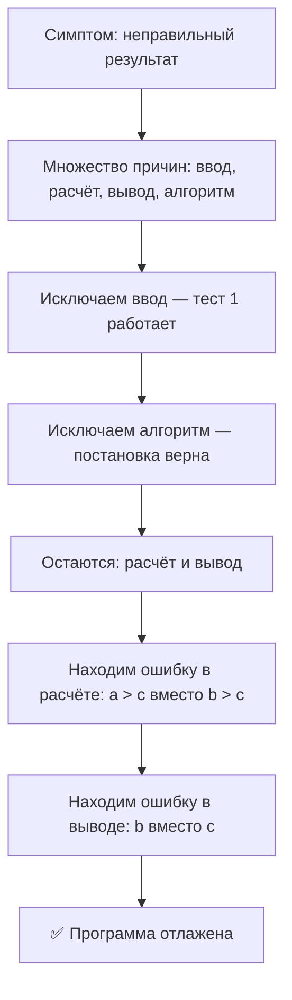
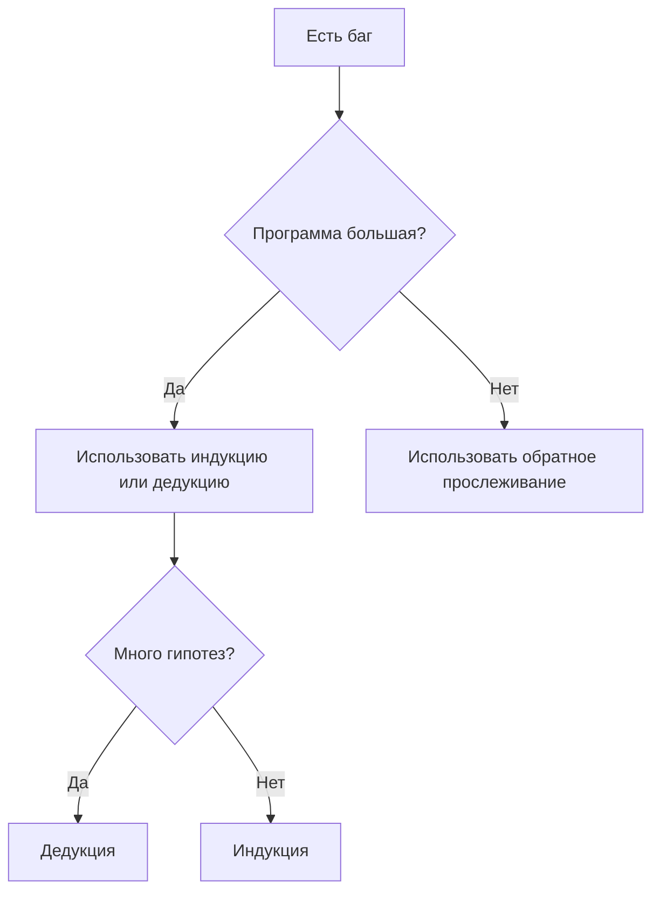

# 📚 ЛЕКЦИЯ 4: Виды ошибок и методы отладки

**Дисциплина:** МДК 01.02 Поддержка и тестирование программных модулей  
**Группа:** 2 курс  
**Преподаватель:** Сафиулин Руслан Ринатович  

---

| Предыдущее занятие | | Следующее занятие |
|:----------------:|:-----------------------:|:----------------:|
| [ЛЕКЦИЯ 3](LESSON3.MD) | [Содержание](README.MD) | [ЛР 1](..%2FLR1%2FLR_1.MD) |

---

# 📑 Оглавление

- [🎯 Цели урока](#-цели-урока)
- [🗂️ План урока](#️-план-урока)
- [📖 1. Организационный момент и входное тестирование](#-1-организационный-момент-и-входное-тестирование)
  - [📌 Входное тестирование (проверка ДЗ с прошлого занятия)](#-входное-тестирование-проверка-дз-с-прошлого-занятия)
  - [📌 Объявление темы](#-объявление-темы)
- [🔥 2. Мотивационный блок](#-2-мотивационный-блок)
- [🔧 3. Что такое отладка](#-3-что-такое-отладка)
  - [📌 Два вида отладки](#-два-вида-отладки)
- [🔍 4. Локализация ошибок](#-4-локализация-ошибок)
  - [📌 Алгоритм локализации ошибки](#-алгоритм-локализации-ошибки)
  - [📌 Способы обнаружения ошибок](#-способы-обнаружения-ошибок)
- [📏 5. Принципы отладки](#-5-принципы-отладки)
- [🐛 6. Виды ошибок](#-6-виды-ошибок)
  - [📌 Классификация ошибок](#-классификация-ошибок)
  - [🔴 6.1. Ошибки компиляции (синтаксические)](#-61-ошибки-компиляции-синтаксические)
  - [🔗 6.2. Ошибки компоновки](#-62-ошибки-компоновки)
  - [💥 6.3. Ошибки выполнения (runtime)](#-63-ошибки-выполнения-runtime)
  - [🧠 6.4. Логические ошибки (подробнее)](#-64-логические-ошибки-подробнее)
- [🛠️ 7. Методы отладки](#️-7-методы-отладки)
  - [📌 Факторы, усложняющие отладку](#-факторы-усложняющие-отладку)
  - [📌 Классификация методов отладки](#-классификация-методов-отладки)
  - [💪 7.1. Силовые методы](#-71-силовые-методы)
  - [🖐️ 7.2. Метод ручного тестирования](#️-72-метод-ручного-тестирования)
  - [🔍 7.3. Метод индукции (кратко)](#-73-метод-индукции-кратко)
  - [🧩 7.4. Метод дедукции (кратко)](#-74-метод-дедукции-кратко)
  - [⏪ 7.5. Метод обратного прослеживания (кратко)](#-75-метод-обратного-прослеживания-кратко)
- [🎯 8. Разбор методов отладки на одном примере](#-8-разбор-методов-отладки-на-одном-примере)
  - [📖 Условие задачи](#-условие-задачи)
  - [💻 Код программы (с ошибками)](#-код-программы-с-ошибками)
  - [📊 Результаты тестов](#-результаты-тестов)
  - [🔍 РАЗБОР 1: Метод индукции](#-разбор-1-метод-индукции)
  - [🧩 РАЗБОР 2: Метод дедукции](#-разбор-2-метод-дедукции)
  - [⏪ РАЗБОР 3: Метод обратного прослеживания](#-разбор-3-метод-обратного-прослеживания)
  - [📊 Сравнение трёх методов](#-сравнение-трёх-методов-на-одном-примере)
  - [💡 Какой метод выбрать?](#-какой-метод-выбрать)
- [📋 9. Категории программных ошибок](#-9-категории-программных-ошибок)
- [🎯 10. Практический кейс: «Найди баг тремя методами»](#-10-практический-кейс-найди-баг-тремя-методами)
  - [📖 Ситуация](#-ситуация)
  - [💻 Код программы (с ошибкой)](#-код-программы-с-ошибкой)
  - [📊 Результаты тестов](#-результаты-тестов-1)
  - [🎯 Задание для работы в парах](#-задание-для-работы-в-парах-10-минут)
  - [📋 Ожидаемые ответы](#-ожидаемые-ответы-для-преподавателя)
  - [📌 Правильный код](#-правильный-код)
- [🏁 11. Подведение итогов](#-11-подведение-итогов)
  - [📌 Ключевые выводы урока](#-ключевые-выводы-урока)
  - [❓ Вопросы для закрепления](#-вопросы-для-закрепления-устно-на-паре)
- [🏠 Домашнее задание к лекции 4](#-домашнее-задание-к-лекции-4)
  - [📝 ЗАДАНИЕ 1. «Классификация ошибок»](#-задание-1-классификация-ошибок-4-балла)
  - [📝 ЗАДАНИЕ 2. «Три метода на одном баге»](#-задание-2-три-метода-на-одном-баге-5-баллов)
  - [📝 ЗАДАНИЕ 3. «Рефлексия: Самый сложный баг»](#-задание-3-рефлексия-самый-сложный-баг-2-балла)
  - [📤 СДАЧА РАБОТЫ](#-сдача-работы)
  - [⭐ КРИТЕРИИ ОЦЕНКИ](#-критерии-оценки)
- [📋 Тест по лекции 4 (20 вопросов)](#-тест-по-лекции-4-20-вопросов)
  - [⭐ КРИТЕРИИ ОЦЕНИВАНИЯ ТЕСТА](#-критерии-оценивания-теста)

---

## 🎯 Цели урока

| **Обучающая** | **Развивающая** | **Воспитательная** |
|---------------|-----------------|--------------------|
| Сформировать у студентов понимание видов ошибок, принципов локализации и методов отладки программного обеспечения | Развить навыки анализа кода, логического мышления и системного подхода к поиску ошибок | Привить понимание важности методичной работы при отладке и ответственности за качество кода |

---

## 🗂️ План урока

| № | Этап урока | Время |
|---|------------|-------|
| 1 | Организационный момент и входное тестирование | 10 мин |
| 2 | Мотивационный блок | 5 мин |
| 3 | Что такое отладка | 5 мин |
| 4 | Локализация ошибок | 5 мин |
| 5 | Принципы отладки | 5 мин |
| 6 | Виды ошибок | 12 мин |
| 7 | Методы отладки | 10 мин |
| 8 | Разбор методов отладки на одном примере | 15 мин |
| 9 | Категории программных ошибок | 8 мин |
| 10 | Практический кейс: «Найди баг тремя методами» | 10 мин |
| 11 | Подведение итогов и выдача домашнего задания | 5 мин |
| **Итого** | | **90 мин** |

---

## 📖 1. Организационный момент и входное тестирование

Приветствие группы, проверка присутствующих.

### 📌 Входное тестирование (проверка ДЗ с прошлого занятия)

> 💡 *«Прежде чем мы перейдём к новой теме, давайте проверим, как вы усвоили материал прошлого занятия. Тест уже опубликован в Google Формах. Перейдите по ссылке в чате и выполните задания. У вас будет 7-10 минут»*

**Ссылка на тест:** **[255 группа](https://forms.gle/jZUJoJRT6kFJgrP67)** | **[257 группа](https://forms.gle/P1Tt7j9VJYgkwTRE9)**

| Количество баллов | Оценка |
|--------|----------|
|🟢 19-20 баллов | 5️⃣(😎) |
|🟡 17-18 баллов | 4️⃣(😇) | 
|🟠 12-16 баллов | 3️⃣(😬 ) | 
|🔴 0-11 баллов | 2️⃣(🤬) |

---

### 📌 Объявление темы

> 💡 *«Сегодня мы разберёмся с тем, что происходит после того, как программа написана и запущена. Мы изучим виды ошибок, узнаем, как их локализовать, и освоим методы отладки. Эти знания — фундамент для предстоящей лабораторной работы, где вы будете отлаживать код в IntelliJ IDEA».*

---

## 🔥 2. Мотивационный блок

### 📌 Вопрос к группе:
*«Что вы делаете, когда программа не работает? С чего начинаете поиск ошибки?»*

### 📌 Мем-ситуация:

> *«Запускаю свой код»* → *«800 строк — 900 ошибок»*

**Обсуждение:** Знакома ли вам такая ситуация? Почему так происходит?

**Вывод:** Отладка — это **не хаотичный поиск**, а системный процесс. Сегодня мы научимся отлаживать код **методично**, а не методом «тыка».

---

## 🔧 3. Что такое отладка

**Отладка** — это процесс **локализации и исправления ошибок** в программе.

> 💡 Отладка — это не просто «поиск багов». Это целый процесс, включающий анализ, выдвижение гипотез, проверку и исправление.

### 📌 Два вида отладки



| Вид отладки | Что исправляет | Сложность |
|-------------|----------------|-----------|
| **Синтаксическая** | Ошибки в записи кода (пропущенные скобки, точки с запятой) | ✅ Низкая — компилятор подскажет |
| **Семантическая (смысловая)** | Ошибки в логике работы программы | ⚠️ Высокая — нужно думать самому |

> 💡 **Ключевая мысль:** Синтаксические ошибки находит компилятор, а семантические — только человек. Именно поэтому отладка — это интеллектуальная работа.

---

## 🔍 4. Локализация ошибок

**Локализация** — это процесс определения оператора программы, выполнение которого вызвало нарушение нормального вычислительного процесса.

> ⚠️ **Важно:** Для исправления ошибки нужно найти не её **симптом**, а её **причину** — конкретный оператор или фрагмент кода.

### 📌 Алгоритм локализации ошибки



### 📌 Способы обнаружения ошибок

| Способ | Когда использовать | Пример |
|--------|-------------------|--------|
| **Аналитический** | Когда есть представление о структуре программы | Внимательный просмотр кода, поиск опечаток |
| **Экспериментальный** | Когда причина неочевидна | Отладочная печать, трассировка, брейкпоинты |

---

## 📏 5. Принципы отладки

| № | Принцип | Пояснение |
|---|---------|-----------|
| 1 | 🔍 **Большинство ошибок обнаруживается без запуска программы** | Внимательный просмотр текста часто выявляет опечатки и логические ошибки |
| 2 | 🧘 **Если отладка зашла в тупик — отложите программу** | Свежий взгляд через час-два часто помогает найти решение |
| 3 | 🛠️ **Используйте отладочные механизмы среды разработки** | Трассировка, промежуточный контроль значений, брейкпоинты |
| 4 | 🚫 **Избегайте экспериментов «а что будет, если изменить плюс на минус»** | Это хаотичный подход, который приводит к новым ошибкам |
| 5 | 🔎 **Там, где найдена одна ошибка, возможно, есть и другие** | Ошибки часто «кучкуются» — проверьте соседние участки кода |
| 6 | ⚠️ **Вероятность, что ошибка найдена правильно, никогда не равна 100%** | Всегда проверяйте, что исправление не сломало другой функционал |
| 7 | 🎯 **Наша задача — найти саму ошибку, а не её симптом** | Лечение симптома без устранения причины приведёт к рецидиву |

---

## 🐛 6. Виды ошибок

### 📌 Классификация ошибок



---

### 🔴 6.1. Ошибки компиляции (синтаксические)

**Определение:** Синтаксические ошибки, фиксируемые компилятором.

**Характеристика:**
- ✅ Самые простые — компилятор точно указывает место и причину.
- ✅ Синтаксис языка строго формализован, поэтому ошибок этого типа много, но они легко исправляются.

**Пример:**

```java
double a = scanner.next();  // ❌ Ошибка: Required type: double, Provided: String
```

> 💡 **Вывод:** Исправляйте ошибки компиляции сразу — не переходите к запуску, пока код не компилируется.

---

### 🔗 6.2. Ошибки компоновки

**Определение:** Ошибки, обнаруженные компоновщиком при объединении модулей программы.

**Примеры:**
- Обращение к подпрограмме другого модуля, но она не найдена.
- Не стыкуются списки параметров.
- Несовпадение типов возвращаемых значений.

> 💡 **Вывод:** Ошибки компоновки возникают при неправильном взаимодействии модулей — проверьте интерфейсы.

---

### 💥 6.3. Ошибки выполнения (runtime)

**Определение:** Ошибки, обнаруженные ОС, аппаратными средствами или пользователем при выполнении программы.

**Характеристика:** Самые непредсказуемые и сложные для локализации.

**Проявления:**
- 📛 Сообщение об ошибке (деление на ноль, нарушение адресации).
- 🖥️ Сообщение ОС (попытка записи в защищённую память).
- 🔄 «Зависание» компьютера.
- ❌ Несовпадение полученных результатов с ожидаемыми.

**Причины ошибок выполнения:**

| Группа | Описание | Пример |
|--------|----------|--------|
| **Ошибки определения данных** | Неверное определение исходных данных | Ошибки передачи, преобразования |
| **Логические ошибки** | Ошибки в логике программы | Неправильный алгоритм, неверное условие |
| **Ошибки накопления погрешностей** | Накопление погрешностей при вычислениях | Некорректное отбрасывание дробных цифр |

---

### 🧠 6.4. Логические ошибки (подробнее)

**К ошибкам кодирования относятся:**

| Тип ошибки | Пример |
|------------|--------|
| **Некорректное использование переменных** | Неудачный выбор типа, использование до инициализации, выход за границы массива |
| **Ошибки вычислений** | Некорректная работа с переменными, неверное преобразование типов |
| **Ошибки взаимодействия модулей** | Нарушение типов и последовательности параметров, нарушение области видимости |

> 💡 **Вывод:** Логические ошибки — самые коварные. Их не находит компилятор, и они могут проявиться только при определённых данных.

---

## 🛠️ 7. Методы отладки

### 📌 Факторы, усложняющие отладку

| Фактор | Пояснение |
|--------|-----------|
| **Опосредованное проявление ошибок** | Ошибка в одном месте проявляется в другом |
| **Взаимное влияние ошибок** | Одна ошибка маскирует другую |
| **Одинаковые проявления разных ошибок** | Разные причины дают одинаковый симптом |
| **Стохастические ошибки** | Могут не проявиться от запуска к запуску |
| **Изменение проявления при диагностике** | Включение отладочной печати может изменить поведение программы |

---

### 📌 Классификация методов отладки



---

### 💪 7.1. Силовые методы

| Метод | Описание | Когда использовать |
|-------|----------|-------------------|
| **Дамп памяти** | Снимок состояния памяти в момент сбоя | Крайний случай, для сложных систем |
| **Отладочная печать** | Вставка `System.out.println()` в код | Небольшие проекты, быстрая проверка |
| **Автоматические средства отладки** | Трассировка, брейкпоинты, отслеживание переменных | Основной инструмент в IDE |

> 💡 **Практические советы:**
> - Используйте трассировку и отслеживание переменных для небольших проектов.
> - Отладочную печать — в небольших количествах и «по делу».
> - Дамп памяти — на самый крайний случай.

---

### 🖐️ 7.2. Метод ручного тестирования

**Суть:** Выполнение программы вручную с тестовым набором, при котором была обнаружена ошибка.

**Плюсы:** Простой и естественный.
**Минусы:** Не применим для больших систем и сложных вычислений.

---

### 🔍 7.3. Метод индукции (кратко)

**Суть:** Идём **от симптомов к причине**. Анализируем проявления ошибки → выдвигаем гипотезы → проверяем.

---

### 🧩 7.4. Метод дедукции (кратко)

**Суть:** Идём **от общего к частному**. Формируем множество причин → исключаем противоречащие данным → доказываем наиболее вероятную.

---

### ⏪ 7.5. Метод обратного прослеживания (кратко)

**Суть:** Идём **от результата к причине**. Определяем точку вывода неправильного результата и «пятимся» назад по коду.

> ⚠️ *Подробный разбор всех трёх методов на одном примере — в следующем разделе.*

---

## 🎯 8. Разбор методов отладки на одном примере

Чтобы понять разницу между методами, разберём **один и тот же баг** тремя способами.

### 📖 Условие задачи

Программа должна находить **максимальное из трёх введённых чисел**. Но при вводе `-2, 8, 4` она выдаёт **неправильный текст** (говорит «третье число», хотя максимум — второе).

### 💻 Код программы (с ошибками)

```java
import java.util.Scanner;

public class Main {
    public static void main(String[] args) {
        Scanner scanner = new Scanner(System.in);
        System.out.println("Программа находит значение максимального из трех введенных чисел!");
        System.out.print("Введите первое число a = ");
        double a = scanner.nextDouble();
        System.out.print("Введите второе число b = ");
        double b = scanner.nextDouble();
        System.out.print("Введите третье число c = ");
        double c = scanner.nextDouble();

        if (a > b && a > c)
            System.out.printf("Наибольшим оказалось первое число %.2f", a);
        else if (b > a && a > c)   // ← ОШИБКА №1
            System.out.printf("Наибольшим оказалось второе число %.2f", b);
        else
            System.out.printf("Наибольшим оказалось третье число %.2f", b);  // ← ОШИБКА №2
    }
}
```

### 📊 Результаты тестов

| № | A | B | C | Ожидаемый результат | Фактический результат |
|---|---|---|----|---------------------|----------------------|
| 1 | 10 | 4 | 1 | 10 | 10 ✅ |
| 2 | -2 | 8 | 4 | 8, текст «второе число» | 8, текст «третье число» ❌ |
| 3 | 90 | 0 | 95 | 95, текст «третье число» | 0, текст «третье число» ❌ |

---

### 🔍 РАЗБОР 1: Метод индукции

**Логика:** Идём **от симптомов к причине**. Сначала смотрим, **что** не так, потом ищем **где**.

**Шаг 1. Анализируем симптомы**

Смотрим на результаты тестов:
- Тест 1 — всё хорошо.
- Тест 2 — ошибка, когда максимум — **второе число**.
- Тест 3 — ошибка, когда максимум — **третье число**.

**Вывод:** Ошибка проявляется, когда максимум — **b или c**, а не `a`.

**Шаг 2. Выдвигаем гипотезу**

Смотрим на код, связанный с `b` и `c`:

```java
else if (b > a && a > c)   // ← проверяем условие для b
    System.out.printf("... второе число %.2f", b);
else
    System.out.printf("... третье число %.2f", b);  // ← вывод для c
```

**Гипотеза №1:** В выводе для третьего числа используется переменная `b`, а должна быть `c`.

**Шаг 3. Проверяем гипотезу**

Вводим `-2, 8, 4`. Программа говорит: «Наибольшим оказалось **третье** число **8,00**».
- Текст «третье число» — потому что сработала ветка `else`.
- Значение `8,00` — это переменная `b`, но в тексте написано «третье», значит, должно быть `c`.

**Гипотеза подтвердилась!** ✅

**Шаг 4. Ищем дальше**

Исправляем `b` → `c` в последней строке. Запускаем снова `-2, 8, 4`.
Теперь программа говорит: «Наибольшим оказалось **третье** число **4,00**». Но максимум — `8`!

**Гипотеза №2:** Ошибка в условии `else if (b > a && a > c)` — здесь `a > c` вместо `b > c`.

Проверяем: при `b = 8, a = -2, c = 4`:
- `b > a` → `8 > -2` → **true** ✅
- `a > c` → `-2 > 4` → **false** ❌

Условие не выполняется, поэтому идём в `else`. **Гипотеза подтвердилась!**

**Исправление:** `else if (b > a && b > c)`.

**Итог по методу индукции:**



---

### 🧩 РАЗБОР 2: Метод дедукции

**Логика:** Идём **от общего к частному**. Формулируем **все возможные причины** проблемы, а потом **исключаем** те, что не подходят.

**Шаг 1. Формируем множество причин**

Почему программа может выдавать неправильный результат?

| № | Возможная причина |
|---|-------------------|
| 1 | Ошибка при вводе данных |
| 2 | Ошибка в расчётном блоке (условия `if/else if/else`) |
| 3 | Ошибка в блоке вывода |
| 4 | Ошибка в самом алгоритме (неверная постановка задачи) |

**Шаг 2. Исключаем противоречащие данным**

- **Причина 1 (ввод):** Смотрим на тесты. Тест 1 работает правильно — значит, ввод корректный. **Исключаем.**
- **Причина 4 (алгоритм):** Алгоритм верный — сравнить три числа и вывести максимум. **Исключаем.**
- **Остаются:** причина 2 (расчёт) и причина 3 (вывод).

**Шаг 3. Доказываем наиболее вероятную гипотезу**

Работаем с **расчётным блоком** (условия):

```java
if (a > b && a > c)         // верно
else if (b > a && a > c)    // ← ошибка: должно быть b > c
else                        // верно
```

Проверяем на данных `-2, 8, 4`: `b > a` (true), `a > c` (false) → условие не срабатывает → идём в `else`. **Ошибка найдена!**

Затем смотрим на **блок вывода**:

```java
else
    System.out.printf("... третье число %.2f", b);  // ← ошибка: должно быть c
```

Вводим `90, 0, 95`. Программа выводит `0` вместо `95`. **Ошибка найдена!**

**Шаг 4. Проверяем оставшиеся причины**

Все остальные причины уже исключены. **Программа отлажена.**

**Итог по методу дедукции:**



---

### ⏪ РАЗБОР 3: Метод обратного прослеживания

**Логика:** Идём **от результата к причине**. Сначала смотрим, **где** неправильный вывод, а потом «пятимся» назад по коду.

**Шаг 1. Определяем точку неправильного результата**

Из теста 2 (`-2, 8, 4`) видим, что программа выводит:

```
Наибольшим оказалось третье число 8,00
```

**Точка ошибки — последний `System.out.printf`.**

**Шаг 2. Строим гипотезу о значениях переменных**

Смотрим на строку:

```java
System.out.printf("... третье число %.2f", b);
```

Что здесь не так?
- Переменная `b = 8` — это максимум. Правильно.
- Но текст «третье число» — а максимум — **второе**. Значит, сработала ветка `else`, хотя должна была сработать ветка `else if`.

**Гипотеза:** Ошибка в условии `else if`.

**Шаг 3. Идём к предыдущей точке**

Смотрим на условие:

```java
else if (b > a && a > c)
```

При `b = 8, a = -2, c = 4`:
- `b > a` → true ✅
- `a > c` → `-2 > 4` → **false** ❌

Условие не сработало → пошли в `else`. **Причина найдена!**

**Шаг 4. Исправляем условие**

Меняем `a > c` на `b > c`. Теперь условие сработает правильно.

**Шаг 5. Проверяем следующую ветку**

Запускаем тест 3 (`90, 0, 95`). Программа выводит `0` вместо `95`.
Идём по коду назад: последний `else` выводит `b`, а надо `c`. **Вторая причина найдена!**

**Итог по методу обратного прослеживания:**


---

### 📊 Сравнение трёх методов на одном примере

| Критерий | Индукция | Дедукция | Обратное прослеживание |
|----------|----------|----------|------------------------|
| **Направление** | От симптома → к причине | От общего → к частному | От результата → назад по коду |
| **С чего начинаем** | Анализ проявлений ошибки | Множество возможных причин | Точка вывода неправильного результата |
| **Когда использовать** | Когда есть симптомы, но причина неясна | Когда есть много гипотез | Небольшие программы с известным результатом |
| **Плюсы** | Хорошо для сложных багов | Системный подход, не пропускает причин | Быстро локализует ошибку в небольших программах |
| **Минусы** | Может потребоваться много итераций | Требует опыта для формирования причин | Не подходит для больших программ |

---

### 💡 Какой метод выбрать?



> 💡 **Совет:** На лабораторной работе вы будете использовать **автоматические средства отладки** (брейкпоинты, трассировка) — это практическая реализация **метода обратного прослеживания**. Вы ставите точку останова, смотрите значения переменных и «пятитесь» назад по коду, пока не найдёте причину.

---

## 📋 9. Категории программных ошибок

| № | Категория | Описание | Пример |
|---|-----------|----------|--------|
| 1 | 🎯 **Функциональные недостатки** | Программа не делает то, что должна | Не работает кнопка «Сохранить» |
| 2 | 🎨 **Недостатки пользовательского интерфейса** | Неудобный, непонятный интерфейс | Кнопка «Выход» в неожиданном месте |
| 3 | ⚡ **Недостаточная производительность** | Программа работает медленнее, чем в требованиях | Загрузка 10 секунд вместо 1 |
| 4 | ⚠️ **Некорректная обработка ошибок** | Программа не выдаёт сообщение об ошибке | При делении на ноль — «зависание» |
| 5 | 📏 **Некорректная обработка граничных условий** | Ошибки на границах диапазонов | При вводе 0 или максимального числа — сбой |
| 6 | 🧮 **Ошибки вычислений** | Неправильные формулы, алгоритмы, округление | Неверный расчёт скидки |
| 7 | 🔀 **Ошибки управления потоком** | Выполняется не та ветка кода | Вместо второго действия — третье |
| 8 | 🏁 **Ситуация гонок** | События происходят в неверном порядке | Два потока одновременно изменяют данные |
| 9 | 📈 **Перегрузки** | Нехватка памяти или ресурсов | Программа падает при больших объёмах данных |
| 10 | 🖥️ **Некорректная работа с аппаратурой** | Неверные данные устройствам | Программа «зависает» при обращении к занятому устройству |

---

## 🎯 10. Практический кейс: «Найди баг тремя методами»

### 📖 Ситуация

Перед вами программа на Java, которая должна **вычислять среднее арифметическое трёх введённых чисел**. Но в ней есть **ошибка**, из-за которой результат получается неправильным.

Ваша задача — **найти ошибку тремя методами отладки**: индукцией, дедукцией и обратным прослеживанием. Для каждого метода заполните свою таблицу.

---

### 💻 Код программы (с ошибкой)

```java
import java.util.Scanner;

public class Main {
    public static void main(String[] args) {
        Scanner scanner = new Scanner(System.in);
        System.out.println("Программа вычисляет среднее арифметическое трёх чисел!");
        System.out.print("Введите первое число a = ");
        double a = scanner.nextDouble();
        System.out.print("Введите второе число b = ");
        double b = scanner.nextDouble();
        System.out.print("Введите третье число c = ");
        double c = scanner.nextDouble();

        double average = (a + b + c) / 2;   // ← ОШИБКА ЗДЕСЬ?

        System.out.printf("Среднее арифметическое = %.2f", average);
    }
}
```

---

### 📊 Результаты тестов

| № теста | A | B | C | Ожидаемый результат | Фактический результат |
|---------|---|---|---|---------------------|----------------------|
| 1 | 10 | 20 | 30 | 20,00 | 30,00 ❌ |
| 2 | 3 | 6 | 9 | 6,00 | 9,00 ❌ |
| 3 | 100 | 200 | 300 | 200,00 | 300,00 ❌ |

> ⚠️ **Обратите внимание:** программа работает **стабильно неправильно** — во всех тестах результат завышен.

---

### 🎯 Задание для работы в парах (10 минут)

#### Этап 1. Индивидуальный анализ (4 минуты)

Каждый студент **самостоятельно** анализирует код и пытается найти ошибку **тремя методами**.

---

#### 🔍 Метод 1: ИНДУКЦИЯ (от симптома к причине)

**Логика метода:** анализируем проявления ошибки → выдвигаем гипотезы → проверяем.

| Шаг | Ваши действия | Ваш ответ |
|-----|---------------|-----------|
| **1. Симптомы** | Что общего во всех неправильных результатах? | |
| **2. Анализ данных** | Какие переменные участвуют в расчёте? | |
| **3. Гипотеза** | Что может быть не так в формуле? | |
| **4. Проверка** | Проверьте гипотезу на тесте №1 (10, 20, 30) | |
| **5. Вывод** | Какая строка содержит ошибку? Как исправить? | |

---

#### 🧩 Метод 2: ДЕДУКЦИЯ (от общего к частному)

**Логика метода:** формируем множество причин → исключаем противоречащие → доказываем наиболее вероятную.

| Шаг | Ваши действия | Ваш ответ |
|-----|---------------|-----------|
| **1. Множество причин** | Перечислите ВСЕ возможные причины неправильного результата (не менее 4) | 1.<br>2.<br>3.<br>4. |
| **2. Исключение** | Какую причину можно исключить сразу? Почему? | |
| **3. Остаток** | Какие причины остались? | |
| **4. Доказательство** | Какую гипотезу вы будете доказывать? | |
| **5. Проверка** | Проверьте на данных теста №2 (3, 6, 9) | |
| **6. Вывод** | Какая строка содержит ошибку? Как исправить? | |

---

#### ⏪ Метод 3: ОБРАТНОЕ ПРОСЛЕЖИВАНИЕ (от результата к причине)

**Логика метода:** определяем точку неправильного результата → «пятимся» назад по коду.

| Шаг | Ваши действия | Ваш ответ |
|-----|---------------|-----------|
| **1. Точка ошибки** | В какой строке выводится неправильный результат? | |
| **2. Значение переменной** | Какое значение имеет `average` в тесте №1 (10, 20, 30)? | |
| **3. Откуда взялось?** | По какой формуле было получено это значение? | |
| **4. Идём назад** | Какая строка вычисляет `average`? | |
| **5. Причина** | Что не так в этой формуле? | |
| **6. Вывод** | Как исправить? | |

---

#### Этап 2. Обсуждение в парах (3 минуты)

Обсудите с соседом по парте:
1. Совпали ли ваши результаты по трём методам?
2. Какой метод оказался **самым быстрым** для этой задачи?
3. Какой метод — **самым надёжным**?
4. Аргументируйте, почему ошибка именно в этой строке.

---

#### Этап 3. Общее обсуждение (3 минуты)

Преподаватель показывает правильный ответ.

---

### 📋 Ожидаемые ответы (для преподавателя)

#### 🔍 Метод 1: ИНДУКЦИЯ — разбор

| Шаг | Действия | Ответ |
|-----|----------|-------|
| **1. Симптомы** | Что общего во всех неправильных результатах? | Во **всех** тестах результат **завышен** ровно в **1.5 раза** (30 вместо 20, 9 вместо 6, 300 вместо 200) |
| **2. Анализ данных** | Какие переменные участвуют в расчёте? | `a`, `b`, `c`, `average` |
| **3. Гипотеза** | Что может быть не так в формуле? | Делитель неправильный — вместо `3` стоит `2` |
| **4. Проверка** | Проверьте гипотезу на тесте №1 (10, 20, 30) | `(10 + 20 + 30) / 2 = 60 / 2 = 30` — совпадает с фактическим результатом! Гипотеза верна ✅ |
| **5. Вывод** | Какая строка содержит ошибку? Как исправить? | Строка `double average = (a + b + c) / 2;` — заменить `2` на `3` |

> 💡 **Суть метода индукции:** мы **увидели закономерность** в симптомах (результат всегда в 1.5 раза больше) и от неё пришли к причине.

---

#### 🧩 Метод 2: ДЕДУКЦИЯ — разбор

| Шаг | Действия | Ответ |
|-----|----------|-------|
| **1. Множество причин** | Перечислите ВСЕ возможные причины | 1. Неверный ввод данных<br>2. Ошибка в формуле расчёта<br>3. Ошибка в выводе результата<br>4. Неверный алгоритм (не та задача) |
| **2. Исключение** | Какую причину можно исключить сразу? | **Причина 1 (ввод)** — ввести три числа программа может правильно, это видно по коду.<br>**Причина 4 (алгоритм)** — задача сформулирована верно (среднее арифметическое). |
| **3. Остаток** | Какие причины остались? | **Причина 2 (формула)** и **причина 3 (вывод)** |
| **4. Доказательство** | Какую гипотезу доказываем? | **Причина 2** — ошибка в формуле расчёта `average` |
| **5. Проверка** | Проверьте на данных теста №2 (3, 6, 9) | По коду: `(3 + 6 + 9) / 2 = 18 / 2 = 9`. Ожидалось `6`. Ошибка в делителе ✅ |
| **6. Вывод** | Какая строка содержит ошибку? | `double average = (a + b + c) / 2;` — делить нужно на `3` |

> 💡 **Суть метода дедукции:** мы **сформулировали все возможные причины**, **исключили** неверные, а затем **доказали** оставшуюся.

---

#### ⏪ Метод 3: ОБРАТНОЕ ПРОСЛЕЖИВАНИЕ — разбор

| Шаг | Действия | Ответ |
|-----|----------|-------|
| **1. Точка ошибки** | В какой строке выводится неправильный результат? | `System.out.printf("Среднее арифметическое = %.2f", average);` |
| **2. Значение переменной** | Какое значение имеет `average` в тесте №1 (10, 20, 30)? | `30.00` (вместо ожидаемого `20.00`) |
| **3. Откуда взялось?** | По какой формуле было получено это значение? | `(10 + 20 + 30) / 2 = 30` |
| **4. Идём назад** | Какая строка вычисляет `average`? | `double average = (a + b + c) / 2;` |
| **5. Причина** | Что не так в этой формуле? | Делим на `2`, а нужно на `3` — по определению среднего арифметического |
| **6. Вывод** | Как исправить? | `double average = (a + b + c) / 3;` |

> 💡 **Суть метода обратного прослеживания:** мы **начали с вывода** неправильного результата и **пошагово вернулись** к строке, где он был вычислен.

---

### 📌 Правильный код

```java
import java.util.Scanner;

public class Main {
    public static void main(String[] args) {
        Scanner scanner = new Scanner(System.in);
        System.out.println("Программа вычисляет среднее арифметическое трёх чисел!");
        System.out.print("Введите первое число a = ");
        double a = scanner.nextDouble();
        System.out.print("Введите второе число b = ");
        double b = scanner.nextDouble();
        System.out.print("Введите третье число c = ");
        double c = scanner.nextDouble();

        double average = (a + b + c) / 3;   // ✅ ИСПРАВЛЕНО: делим на 3

        System.out.printf("Среднее арифметическое = %.2f", average);
    }
}
```

---

### 📊 Сравнение трёх методов на этом примере

| Критерий | Индукция | Дедукция | Обратное прослеживание |
|----------|----------|----------|------------------------|
| **Направление** | От симптома → к причине | От общего → к частному | От результата → назад по коду |
| **С чего начали** | Закономерность: результат всегда в 1.5 раза больше | Список из 4 возможных причин | Строка вывода результата |
| **Сколько шагов** | 5 | 6 | 6 |
| **Что помогло** | Анализ закономерности | Системное исключение | Движение назад по коду |
| **Скорость** | ⚡ Быстро | 🐢 Медленнее | ⚡ Быстро |
| **Надёжность** | ⭐⭐ Средняя | ⭐⭐⭐ Высокая | ⭐⭐ Средняя |
| **Когда удобен** | Когда видна закономерность в симптомах | Когда причин может быть много | Когда программа небольшая |

> 💡 **Вывод:** для этой задачи **все три метода привели к одному результату**. Но:
> - **Индукция** сработала быстрее всего — закономерность была очевидна.
> - **Дедукция** дала **гарантию**, что мы ничего не пропустили.
> - **Обратное прослеживание** было удобно, потому что код короткий.

---

### 🎯 Критерии оценивания практики (для преподавателя)

| Критерий | Баллы |
|----------|-------|
| Заполнена таблица по методу индукции (все 5 шагов) | 1 |
| Заполнена таблица по методу дедукции (все 6 шагов) | 1 |
| Заполнена таблица по методу обратного прослеживания (все 6 шагов) | 1 |
| Правильно определена ошибка (`/ 2` вместо `/ 3`) | 1 |
| Аргументирован выбор самого эффективного метода | 1 |
| **Итого** | **5 баллов** |

---

### 💡 Методические рекомендации для преподавателя

1. **На этапе 1** напомните: «Не обсуждайте, работайте самостоятельно. Каждый метод — отдельная таблица».
2. **На этапе 2** подходите к парам и слушайте. Сравнивайте, какой метод студенты используют чаще.
3. **На этапе 3** покажите правильный ответ и **объясните**, что все три метода привели к одному результату — это **сила системного подхода**.
4. **Связь с ЛР1:** «На лабораторной работе вы будете использовать метод обратного прослеживания через брейкпоинты — поставите точку на выводе и пойдёте назад по коду».
5. **Дополнительный вопрос для сильных студентов:** *«А если бы программа выдавала результат, который не совпадает ни с одним ожидаемым, какой метод был бы эффективнее?»* (Ответ: дедукция — потому что причин может быть много).

---

## 🏁 11. Подведение итогов

### 📌 Ключевые выводы урока

- 🔧 **Отладка** — это процесс локализации и исправления ошибок.
- 🔍 **Локализация** — поиск оператора, вызвавшего нарушение.
- 📏 **Принципы отладки:** внимательный просмотр, использование отладочных средств, поиск причины, а не симптома.
- 🐛 **Виды ошибок:** компиляции (синтаксические), компоновки, выполнения (логические, определения данных, накопления погрешностей).
- 🛠️ **Методы отладки:**
  - **Индукция** — от симптомов к причине.
  - **Дедукция** — от общего к частному (исключение причин).
  - **Обратное прослеживание** — от результата назад по коду.
- 📋 **Категории ошибок:** функциональные, интерфейсные, производительность, обработка ошибок, граничные условия, вычисления, управление потоком, гонки, перегрузки, работа с аппаратурой.
- 🎯 **Главное правило:** найти **причину**, а не симптом!

### ❓ Вопросы для закрепления (устно на паре)

1. 🔧 Что такое отладка? Чем она отличается от тестирования?
2. 🔍 Чем отличается метод индукции от метода дедукции?
3. 🐛 В каком случае удобнее использовать метод обратного прослеживания?
4. 🛠️ Какой метод отладки реализуется через брейкпоинты в IDE?
5. 📋 Приведите пример ошибки из категории «некорректная обработка граничных условий».

---

# 🏠 ДОМАШНЕЕ ЗАДАНИЕ К ЛЕКЦИИ 4

**Тема:** Виды ошибок и методы отладки  
**Формат сдачи:** Письменный отчёт (Microsoft Word, .docx)  
**Срок сдачи:** до 23:59 29 сентября 2026 г.

---

## 📝 ЗАДАНИЕ 1. «Классификация ошибок» (4 балла)

*Это задание проверяет, как вы понимаете виды ошибок и умеете их классифицировать.*

Ниже приведены **6 ситуаций**. Для каждой определите:
- **Вид ошибки** (компиляции, компоновки, выполнения — логическая, определения данных, накопления погрешностей).
- **Категорию ошибки** (функциональная, интерфейсная, производительность, обработка ошибок, граничные условия, вычисления, управление потоком, гонки, перегрузки, работа с аппаратурой).
- **Краткое обоснование** (1-2 предложения).

| № | Ситуация | Вид ошибки | Категория | Обоснование |
|---|----------|------------|-----------|-------------|
| 1 | Программа не компилируется: пропущена точка с запятой | | | |
| 2 | Программа выводит результат «0» вместо «95» при вводе чисел 90, 0, 95 | | | |
| 3 | При вводе числа 0 программа «зависает» | | | |
| 4 | Программа выводит «Наибольшим оказалось третье число 8,00», хотя введены числа -2, 8, 4 | | | |
| 5 | Два потока одновременно изменяют одну переменную, результат непредсказуем | | | |
| 6 | При загрузке большого файла программа падает с ошибкой «OutOfMemoryError» | | | |

---

## 📝 ЗАДАНИЕ 2. «Три метода на одном баге» (5 баллов)

**Ситуация:**

Дана программа, которая должна **находить минимальное из трёх введённых чисел**. Но при вводе `5, 2, 9` она выдаёт `5` вместо `2`.

```java
import java.util.Scanner;

public class Main {
    public static void main(String[] args) {
        Scanner scanner = new Scanner(System.in);
        System.out.print("Введите первое число a = ");
        int a = scanner.nextInt();
        System.out.print("Введите второе число b = ");
        int b = scanner.nextInt();
        System.out.print("Введите третье число c = ");
        int c = scanner.nextInt();

        int min = a;
        if (b < min) min = b;
        if (c < b) min = c;   // ← ОШИБКА ЗДЕСЬ?

        System.out.println("Минимальное число = " + min);
    }
}
```

**Ваша задача:**

1. Найдите ошибку **тремя методами** (индукция, дедукция, обратное прослеживание). Для каждого метода заполните таблицу шагов, как на уроке.
2. Определите, какой метод оказался **самым быстрым** для этой задачи. Обоснуйте (2-3 предложения).
3. Напишите **исправленный код**.

---

## 📝 ЗАДАНИЕ 3. «Рефлексия: Самый сложный баг» (2 балла)

*Это задание на рефлексию и понимание сложности отладки.*

**Вопрос:** Вспомните ситуацию из вашей практики (или учёбы), когда вы долго не могли найти ошибку в коде.

- Что это была за ошибка?
- Каким методом вы её в итоге нашли?
- Какой принцип отладки помог бы вам найти её быстрее?

**Требования к ответу:**
- 5-7 предложений.
- Используйте термины из лекции (локализация, гипотеза, метод индукции/дедукции, отладочная печать).

---

## 📤 СДАЧА РАБОТЫ

**Внимание!** Домашнее задание принимается **только в электронном виде** через Google-форму.

1. 📄 **Оформите отчёт** в Microsoft Word. Объедините все три задания в один документ.
2. 💾 **Сохраните файл** в формате **.docx**.
3. 📛 **Название файла** должно быть по шаблону:  
   `Фамилия_Имя_Группа_Лекция4.docx`  
   *(Например: Иванов_Петр_247_Лекция4.docx)*
4. 🔗 **Перейдите по ссылке** на Google-форму:  
   **[ССЫЛКА НА ФОРМУ ДЛЯ СДАЧИ ДЗ]**
5. ✍️ **Укажите** в форме:
   - Фамилию, Имя
   - Номер группы
6. 📎 **Загрузите** файл с отчётом.
7. ✅ **Нажмите «Отправить»** и убедитесь, что получили уведомление об успешной отправке.

⏰ **Срок сдачи:** до **23:59 29 сентября 2026 г.**  
Работы, сданные после дедлайна, оцениваются сниженным баллом (не более 50% от максимума).

---

## ⭐ КРИТЕРИИ ОЦЕНКИ

| Оценка | Баллы | Требования |
|--------|-------|------------|
| **«5» (Отлично)** | **10-11** | Задание 1 — все 6 ситуаций классифицированы верно. Задание 2 — все три метода применены, таблицы заполнены, ошибка найдена и исправлена. Задание 3 — развёрнутая рефлексия с использованием терминов. |
| **«4» (Хорошо)** | **8-9** | Задание 1 — 5 из 6 ситуаций верны. Задание 2 — применены 2-3 метода, есть небольшие неточности. Задание 3 — рефлексия краткая, но по делу. |
| **«3» (Удовлетворительно)** | **6-7** | Задание 1 — 4 из 6 ситуаций верны. Задание 2 — применён 1 метод или допущены ошибки в шагах. Задание 3 — рефлексия формальная. |
| **«2» (Неудовлетворительно)** | **0-5** | Задания не выполнены или выполнены формально (скопировано без осмысления). |

---

# 📋 ТЕСТ ПО ЛЕКЦИИ 4 (20 ВОПРОСОВ)

**Инструкция:** Выберите один или несколько правильных вариантов ответа. Каждый вопрос — 1 балл. Максимум — 20 баллов.

---

### Вопрос 1
**Что такое отладка программы?**

A) Процесс написания кода  
B) Процесс локализации и исправления ошибок  
C) Процесс тестирования программы  
D) Процесс компиляции  

---

### Вопрос 2
**Какой вид отладки связан с исправлением ошибок в логике работы программы?**

A) Синтаксическая отладка  
B) Семантическая (смысловая) отладка  
C) Компиляционная отладка  
D) Автоматическая отладка  

---

### Вопрос 3
**Что такое локализация ошибки?**

A) Процесс исправления ошибки  
B) Процесс определения оператора, вызвавшего нарушение  
C) Процесс компиляции программы  
D) Процесс запуска программы  

---

### Вопрос 4
**Какой способ обнаружения ошибок предполагает просмотр текста программы без прогона?**

A) Экспериментальный  
B) Аналитический  
C) Автоматический  
D) Статистический  

---

### Вопрос 5
**Сколько принципов отладки мы рассмотрели?**

A) 3  
B) 5  
C) 7  
D) 10  

---

### Вопрос 6
**Какие ошибки являются самыми простыми для исправления?**

A) Ошибки компиляции  
B) Ошибки компоновки  
C) Ошибки выполнения  
D) Логические ошибки  

---

### Вопрос 7
**Что такое ошибки компоновки?**

A) Ошибки, обнаруженные компилятором  
B) Ошибки, обнаруженные компоновщиком при объединении модулей  
C) Ошибки, обнаруженные ОС при выполнении  
D) Ошибки в логике программы  

---

### Вопрос 8
**Какие ошибки являются самыми непредсказуемыми?**

A) Ошибки компиляции  
B) Ошибки компоновки  
C) Ошибки выполнения  
D) Синтаксические ошибки  

---

### Вопрос 9
**Выберите ВСЕ причины ошибок выполнения:**

A) Ошибки определения данных  
B) Логические ошибки  
C) Ошибки накопления погрешностей  
D) Ошибки компиляции  

---

### Вопрос 10
**Что относится к ошибкам кодирования?**

A) Неудачный выбор типов данных  
B) Использование переменной до инициализации  
C) Выход за границы массива  
D) Все перечисленное  

---

### Вопрос 11
**Какой фактор усложняет отладку?**

A) Опосредованное проявление ошибок  
B) Возможность взаимного влияния ошибок  
C) Стохастические ошибки  
D) Все перечисленное  

---

### Вопрос 12
**Какой метод отладки предполагает использование дампа памяти?**

A) Метод индукции  
B) Метод дедукции  
C) Силовые методы  
D) Метод обратного прослеживания  

---

### Вопрос 13
**В чём суть метода индукции?**

A) Идём от результата к причине  
B) Формируем множество причин и исключаем противоречащие  
C) Анализируем симптомы и выдвигаем гипотезы  
D) Используем дамп памяти  

---

### Вопрос 14
**В чём суть метода дедукции?**

A) Идём от результата к причине  
B) Формируем множество причин и исключаем противоречащие  
C) Анализируем симптомы и выдвигаем гипотезы  
D) Используем отладочную печать  

---

### Вопрос 15
**Для каких программ используется метод обратного прослеживания?**

A) Для больших программных систем  
B) Для небольших программ  
C) Для программ со сложными вычислениями  
D) Для многопоточных программ  

---

### Вопрос 16
**Что относится к категории «некорректная обработка граничных условий»?**

A) Ошибки при вводе 0 или максимального числа  
B) Ошибки в формуле расчёта  
C) Ошибки в интерфейсе  
D) Ошибки при работе с аппаратурой  

---

### Вопрос 17
**Выберите ВСЕ категории программных ошибок:**

A) Функциональные недостатки  
B) Недостатки пользовательского интерфейса  
C) Недостаточная производительность  
D) Ошибки компиляции  

---

### Вопрос 18
**Что такое «ситуация гонок»?**

A) Ошибка в формуле расчёта  
B) События происходят в неверном порядке  
C) Программа работает медленно  
D) Ошибка в интерфейсе  

---

### Вопрос 19
**Какой принцип отладки гласит: «Наша задача — найти саму ошибку, а не её симптом»?**

A) Принцип 1  
B) Принцип 4  
C) Принцип 7  
D) Принцип 3  

---

### Вопрос 20
**Какой метод отладки НЕ относится к основным?**

A) Метод индукции  
B) Метод дедукции  
C) Метод обратного прослеживания  
D) Метод случайного перебора  


---

## ⭐ КРИТЕРИИ ОЦЕНИВАНИЯ ТЕСТА

| Оценка | Баллы |
|--------|-------|
| **«5» (Отлично)** | **19–20 баллов** |
| **«4» (Хорошо)** | **17–18 баллов** |
| **«3» (Удовлетворительно)** | **15–16 баллов** |
| **«2» (Неудовлетворительно)** | **14 и менее баллов** |

---
---

*Лекция 4 завершена. Следующее занятие — Лабораторная работа №1 «Отладка», где вы примените полученные знания на практике в IntelliJ IDEA.* 📚🚀
